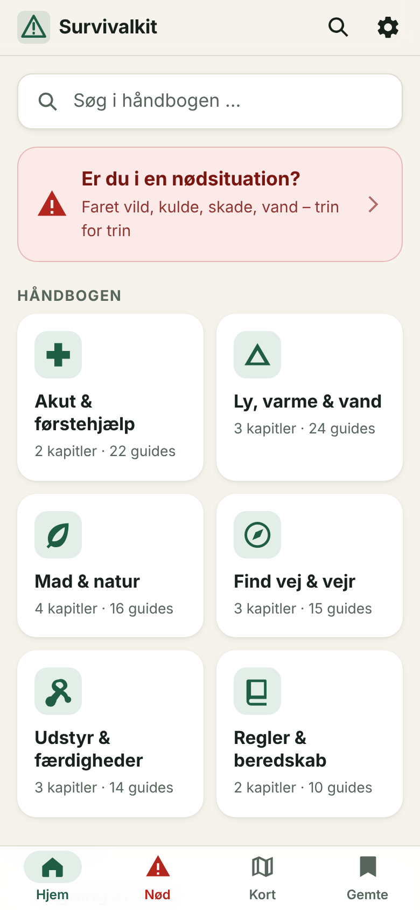
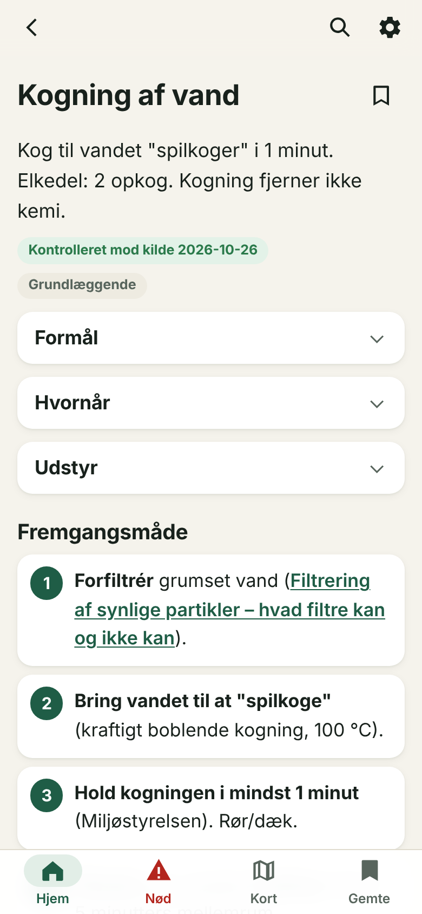
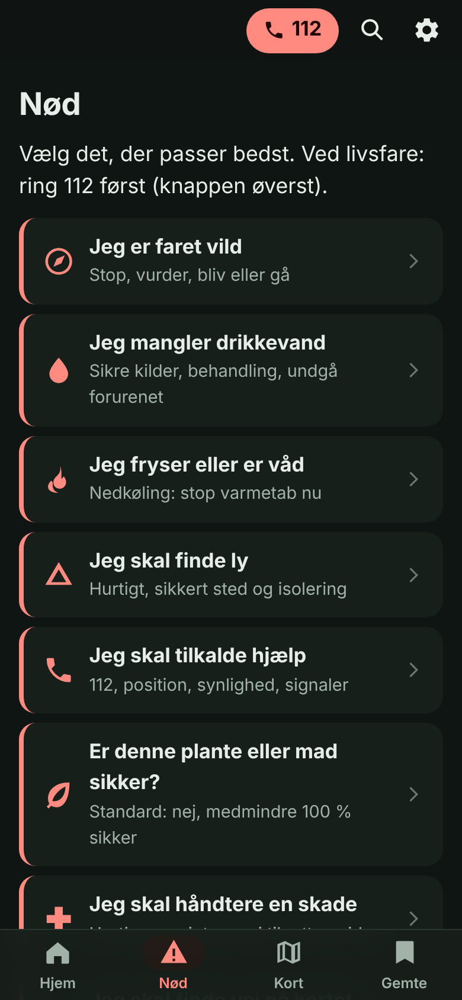
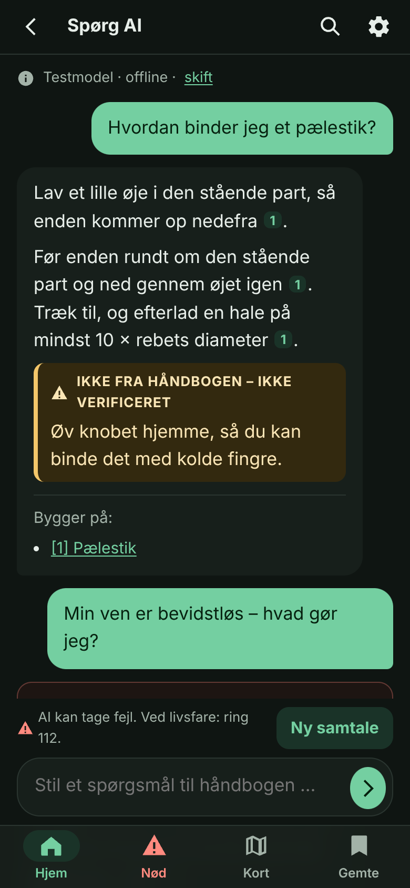

# Survivalkit – dansk feltmanual med offline Djursland-kort

En **offline-first PWA** med en dansk survivalhåndbog, et **topografisk offlinekort over Djursland** og en valgfri **AI-assistent, der kører på telefonen**. Når appen er installeret, virker alt uden internet.

- **Håndbog:** 101 guides i 17 kapitler, 31 arter, 7 tjeklister og 38 registrerede kilder. Hver guide har en kontrolstatus med kilder og dato.
- **Kort:** OpenStreetMap og en højdemodel med højdekurver over Syddjurs og Norddjurs (31 MB). Dækningen er dokumenteret.
- **AI-assistent:** valgfri Gemma 4 (2–3 GB). Den svarer ud fra håndbogen og viser kildelinks.

> **Vigtigt:** Appen erstatter aldrig 112, et førstehjælpskursus eller en kyndig svampe- eller plantekender. Se [docs/BEGRAENSNINGER.md](docs/BEGRAENSNINGER.md) og [docs/VERIFICERING.md](docs/VERIFICERING.md) for, hvad der er kontrolleret mod kilder, og hvad der ikke er.

| Forside | Guide | Nød | AI-assistent |
|---|---|---|---|
|  |  |  |  |

## Brug

Appen er bygget mobile first og har fire faner i bundmenuen. Toplinjen har søgning og indstillinger.

| Fane / sted | Indhold |
|---|---|
| **Hjem** | Søgefelt ("Søg eller spørg …"), nødkort, de 6 temaer og "Fortsæt" (senest læste guide og bogmærker) |
| **Nød** | De 8 nødsituationer, "Ring 112 hvis …", nødprocedure på under ét minut og andre numre |
| **Kort** | Offlinekort over Djursland: lag, GPS, koordinater (WGS84 og UTM32/ETRS89), højde, måling, rute med gangtid, waypoints (GPX ind/ud) og søgning |
| **Gemte** | Bogmærker, tjeklister med fremdrift, noter og nødkontakter. Alt gemmes kun lokalt |
| Søg → **Spørg AI** | Spørgsmål i almindeligt sprog. Svaret bygger på håndbogen og viser kildelinks |
| ⚙ **Indstillinger** | Tema (lyst, mørkt og nat med rødt lys), tekststørrelse, offline og lagring, kortpakke, AI-model, kilder |

**Temaer:**
- Akut & førstehjælp
- Ly, varme & vand
- Mad & natur
- Find vej & vejr
- Udstyr & færdigheder
- Regler & beredskab

**Guides:** de praktiske guides følger samme 9 afsnit: Formål, Hvornår, Udstyr, Fremgangsmåde, Sådan kontrollerer du resultatet, Typiske fejl, Sikkerhed, Danske forhold og Alternativ løsning.
- Fremgangsmåde og Sikkerhed er altid åbne. De øvrige afsnit er foldet sammen og har et advarselsikon, hvis de indeholder fareinformation.
- Hver påstand er mærket *dokumenteret*, *tommelfingerregel* eller *faglig vurdering*.

**112:** knappen vises på Nød-siden og i nød- og førstehjælpsguides. AI-assistenten viser altid "Ring 112" først ved nødord.

Der er **ingen artsfotos og ingen AI-genererede artstegninger**, fordi de kunne give falsk tryghed. Artsguiden er et støtteværktøj, ikke et bestemmelsesværktøj.

## Installation på telefonen

1. Åbn appens adresse over HTTPS, mens du er online.
2. Vælg "Føj til startskærm". På iPhone: Del → "Føj til hjemmeskærm".
3. Hent kortpakken under **Kort** (ca. 31 MB, wifi anbefales).
4. Valgfrit: hent en AI-model under **Søg → Spørg AI** (2–3 GB, wifi).

Derefter virker håndbog, søgning, kort og AI uden net. Service worker, kortpakke og AI kræver `https://` eller `localhost`.

## AI-assistent (valgfri, offline)

- **Svarene** bygger på de 1–4 mest relevante guides eller arter fra håndbogen. Hver kildehenvisning `[1]` er et link til guiden.
- **Egen viden:** hvis modellen tilføjer noget, der ikke står i håndbogen, vises det i en gul boks: "Ikke fra håndbogen – ikke verificeret".
- **Sikkerhedsregler**, som håndhæves af appen og ikke af modellen:
  - Nødord som *bevidstløs*, *bløder* eller *hugormebid* viser altid en "Ring 112"-boks, før modellen svarer.
  - Om førstehjælp, nød og spiselige eller giftige arter vises kun svar med håndbogskilde. Ellers står der ærligt "Det står ikke i håndbogen".
  - Spørgsmål om at spise planter eller svampe får altid reglen "spis kun det, du kender 100 %".
- **Modeller:**
  - Gemma 4 **E4B** (2,96 GB, til nyere telefoner med ca. 8 GB RAM) eller **E2B** (2,0 GB). Begge hentes fra Hugging Face (Apache 2.0).
  - Download kan genoptages, filen kontrolleres med SHA-256, og den gemmes i browserens fillager (OPFS).
  - Modellen kører via MediaPipe og WebGPU. Har browseren indbygget AI (Chrome Prompt API), bruges den i stedet.
- **Krav:** en browser med WebGPU, fx en nyere Chrome på Android. Uden WebGPU forklarer appen, at assistenten ikke kan køre, og søgning virker som normalt.
- **Privatliv:** ingen spørgsmål forlader telefonen, og samtaler gemmes ikke.

Designet står i [docs/superpowers/specs/2026-10-27-ai-chat-design.md](docs/superpowers/specs/2026-10-27-ai-chat-design.md).

## Kortet

MapLibre og PMTiles (vektorfliser z8–14 og en Terrarium-højdemodel z7–13) læses fra IndexedDB. Pakken dækker **kun Djursland** (Syddjurs og Norddjurs + 3 km, uden Anholt). Kort til andre områder er planlagt, men ikke lavet. Datakilder, licenser, pipeline og opdatering står i [docs/KORTDATA.md](docs/KORTDATA.md).

## Udvikling

```bash
npm run build          # bygger indhold (app/data/content.json) og service worker (app/sw.js)
npm run serve          # statisk server på http://127.0.0.1:8080/ (appen = mappen app/)
npm run test:unit      # UTM32 mod pyproj, indholdsvalidering, AI-regler (nødord, kilder, afvisning, SHA-256)
npm run test:e2e       # Playwright/Chromium: 46 tests – funktion, kort, robusthed, fuld offline, UX og AI (~3 min)
node tests/ai_real.mjs # valgfrit: rigtig Gemma 4 E2B (2 GB download, WebGPU; meget langsom uden GPU)
node tools/report.mjs  # genererer docs/VERIFICERING.md, KILDER.md og TESTRESULTATER.md
```

**Forudsætninger:** Node 22 og Chromium (Playwright). Kortpakken genskabes med Python (se [docs/KORTDATA.md](docs/KORTDATA.md)).

**Struktur:**

| Sti | Indhold |
|---|---|
| `content/*.mjs` | Indholdet: kapitler, temaer, guides, arter, lister og kilder. Valideres af `tools/build.mjs` |
| `app/js/views/` | Én fil pr. sidetype (forside, guide, nød, gemte, søg, indstillinger, arter, chat) |
| `app/js/ai/` | AI: motorer, modeldownload, håndbogsopslag og sikkerhedsregler |
| `app/js/mapview.js`, `app/map/` | Kortvisning og kortstil |
| `tools/mapdata/` | Pipeline til kortpakken |
| `tests/` | Enhedstests, e2e og afprøvning med rigtig model |

**Mere dokumentation:** se [docs/ARKITEKTUR.md](docs/ARKITEKTUR.md) og [docs/OFFLINE.md](docs/OFFLINE.md).

## Udgivelse på GitHub Pages

Workflowet `.github/workflows/pages.yml` bygger indholdet, kører enhedstestene og udgiver mappen `app/` ved hver push til `main`. Det kan også køres manuelt via *Actions → Deploy til GitHub Pages → Run workflow*.

Det skal sættes op én gang:
1. Gå til Settings → Pages og vælg *Source: GitHub Actions*.
2. Gå til Settings → Environments → `github-pages` og sørg for, at `main` må udgive.

Så bliver adressen `https://<bruger>.github.io/SurvivalKit/`.

Står Pages i stedet på *Deploy from a branch*, ligger appen under `…/SurvivalKit/app/`.

## Dokumentation

| Fil | Indhold |
|---|---|
| [docs/ARKITEKTUR.md](docs/ARKITEKTUR.md) | Teknisk oversigt, routes og navigation |
| [docs/OFFLINE.md](docs/OFFLINE.md) | Offlinefunktionalitet, lager, opdatering og AI-model offline |
| [docs/KORTDATA.md](docs/KORTDATA.md) | Datakilder, licenser, pipeline, download og opdatering |
| [docs/KILDER.md](docs/KILDER.md) | Alle kilder med understøttet indhold og begrænsninger |
| [docs/VERIFICERING.md](docs/VERIFICERING.md) | Hvad er kontrolleret, og liste over uverificeret indhold |
| [docs/TESTRESULTATER.md](docs/TESTRESULTATER.md) | Faktiske testresultater |
| [docs/BEGRAENSNINGER.md](docs/BEGRAENSNINGER.md) | Kendte begrænsninger, herunder AI-assistentens |
| [docs/superpowers/specs/](docs/superpowers/specs/) | Designspecifikationer (UX-overhaul, AI-chat) |

## Licens

| Del | Licens |
|---|---|
| Kode | MIT (se `LICENSE`) |
| Kortdata | ODbL 1.0 © OpenStreetMap-bidragydere |
| AI-modeller | Gemma 4: Apache 2.0, hentes af brugeren og indgår ikke i repoet |
| MediaPipe | Apache 2.0 (`app/vendor/mediapipe/NOTICE.txt`) |
| Indholdstekster | Ejeren af projektet vælger licens (ikke fastlagt) |
